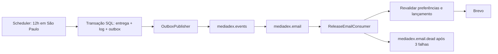

# Lembretes de lançamento por e-mail

## Arquitetura reutilizada do GymFlow

O MediaDex usa o mesmo fluxo do projeto GymFlow: scheduler em um processo Worker separado, outbox transacional no SQL Server, publicação de eventos em RabbitMQ, consumer com confirmação manual, transporte HTTP do Brevo e registros persistentes de entrega/falha.



O worker verifica lançamentos a cada minuto a partir de **12h em America/Sao_Paulo**. Se estiver desligado nesse horário, recupera os lembretes pendentes ao voltar no mesmo dia. Mensagens de dias anteriores são descartadas. O agendamento segue o **dia cadastrado da obra**, sem consultar disponibilidade real de episódios/capítulos em provedores externos.

Recebem lembretes obras em andamento com dia válido e ambos os níveis de preferência ativos. Obras concluídas, totalmente acompanhadas ou cujo cronograma conhecido já terminou são ignoradas; o último lançamento previsto ainda é incluído. Total desconhecido mantém os lembretes semanais até a obra ser inativada/finalizada ou silenciada.

## Configuração

Mesmas chaves do GymFlow: `Brevo:ApiKey`, `Brevo:SenderEmail` e `RabbitMq:ConnectionString`; o nome do remetente é **MediaDex**. Os arquivos disponíveis do GymFlow não continham a chave/remetente reais. Eles precisam ser configurados por variáveis de ambiente ou user-secrets. Nenhum e-mail real é enviado nos testes.

Exemplo para desenvolvimento, na raiz do repositório:

```bash
dotnet user-secrets set "Brevo:ApiKey" "SUA_CHAVE_BREVO" --project deskgeek.csproj
dotnet user-secrets set "Brevo:SenderEmail" "REMETENTE_VALIDADO_NO_BREVO" --project deskgeek.csproj
# API e worker compartilham o UserSecretsId mediadex-local-email.
export DOTNET_ENVIRONMENT=Development
```

Para serviços/produção, use os nomes de variáveis descritos em `.env.email.example`. Arquivos `.env` não são carregados automaticamente pelo .NET. API e worker devem apontar para o mesmo banco SQL Server. `ReleaseReminders:Enabled=false` desliga os três serviços de background sem exigir Brevo/RabbitMQ.

O envio usa `https://api.brevo.com/v3/smtp/email`, header `api-key`, remetente configurável e chave `IdempotencyKey` nos headers transacionais. A chave do provedor complementa o controle persistente no banco. Referência do provedor: [Brevo — envio transacional](https://developers.brevo.com/reference/send-transac-email).

## Preparar e executar

1. Aplique a migration **AddReleaseEmailReminders** antes de subir a API com esta versão. Ela adiciona as preferências com padrão `true`, tabelas `OutboxMessages`, `EmailDeliveries`, `EmailDeliveryLogs` e índices únicos. As demais informações permanecem preservadas.

   ```bash
   dotnet ef database update --project deskgeek.csproj
   ```

2. Reutilize o broker do GymFlow ou inicie um broker local. As filas/exchanges são exclusivas do MediaDex, mesmo quando o broker é compartilhado. Não execute outro broker na mesma porta do GymFlow.

   ```bash
   docker compose -f docker-compose.email.yml up -d
   ```

3. Configure Brevo e inicie o worker **além da API**:

   ```bash
   dotnet run --project Worker/MediaDex.Worker/MediaDex.Worker.csproj
   ```

O worker verifica migrations pendentes no início e não altera o esquema automaticamente. Reinicie o worker após alterar o horário ou as configurações de envio. Para publicar o processo separadamente:

```bash
dotnet publish Worker/MediaDex.Worker/MediaDex.Worker.csproj -c Release -o artifacts/email-worker
```

O diretório publicado recebe `appsettings.json` da aplicação. Configure as variáveis de produção no serviço antes de executá-lo. Não exponha as portas de gerenciamento do RabbitMQ publicamente; o Compose local faz bind em loopback.

## Preferências

- **Perfil → Lembretes por e-mail:** chave geral do usuário. Desligar pausa todas as obras e mantém as escolhas individuais.
- **Card da obra:** ativa/desativa apenas aquela obra; também disponível na criação/edição.
- Preferências são reconsultadas antes do envio. Uma mensagem já enviada não pode ser cancelada. Mensagens já descartadas não são reenviadas ao reativar a preferência no mesmo dia; os próximos agendamentos continuam normalmente.
- Atualizações de preferência exigem autenticação e conferência de propriedade. O calendário de terceiros não expõe as preferências nem links pessoais.

Contratos adicionados:

```text
GET /api/usuario/me
  + receberEmailsLancamentos: boolean
PUT /api/usuario/me/notificacoes
  { "receberEmailsLancamentos": false }
PUT /api/MediaDex/{id}/notificacoes
  { "notificarLancamentos": false }
```

Consulta privada, detalhe, criação e edição de obras incluem `notificarLancamentos`. Na edição, campo ausente preserva a escolha; multipart aceita `true`/`false`. A ação +1 não altera essa preferência nem a preferência geral.

## Entrega, falhas e operação

- Chave única por usuário/obra/data e gravação atômica da entrega, log e evento evitam agendamento duplicado após reinícios.
- Publisher usa mensagens persistentes, roteamento obrigatório e confirmação do broker antes de marcar a outbox processada. Outbox pendente é tentada novamente a cada cinco segundos.
- Consumer usa prefetch 1 e lease SQL de cinco minutos por entrega para impedir processamento simultâneo de mensagens duplicadas. Uma entrega confirmada/descartada é reconhecida sem novo envio.
- Tentativas são persistidas. Falhas de envio recebem espera exponencial (2 e 4 segundos); a terceira falha vai para `mediadex.email.dead`. Indisponibilidade do banco/broker mantém mensagens pendentes.
- Logs SQL registram `Pending`, `Sending`, `Sent`, `Skipped` ou `Failed`, contador de tentativas e último erro. Não registram chave Brevo nem HTML da mensagem.
- Entrega externa não é uma transação com o SQL: uma queda entre aceite pelo Brevo e confirmação no banco tem proteção adicional pela idempotência do provedor, com a janela limitada por ele. Não há promessa de exactly-once absoluta entre sistemas.
- Monitore crescimento da outbox, logs `Failed` e fila morta. Antes de reenfileirar falhas, corrija a causa; mensagens de outra data não serão enviadas como lançamento de hoje.

## Testes

```bash
dotnet test tests/deskgeek.Backend.Tests/deskgeek.Backend.Tests.csproj
cd Client/financias-react
npm test
npm run lint
npm run build
```

Testes relacionais de e-mail usam SQLite em memória com timestamps UTC e não dependem do banco real. O transporte Brevo é interceptado por um handler HTTP de teste. Incluem horário/fuso, preferências em ambos os níveis, último lançamento, duplicação, expiração, leases, limite persistente de tentativas, validação e autorização de alterações.
